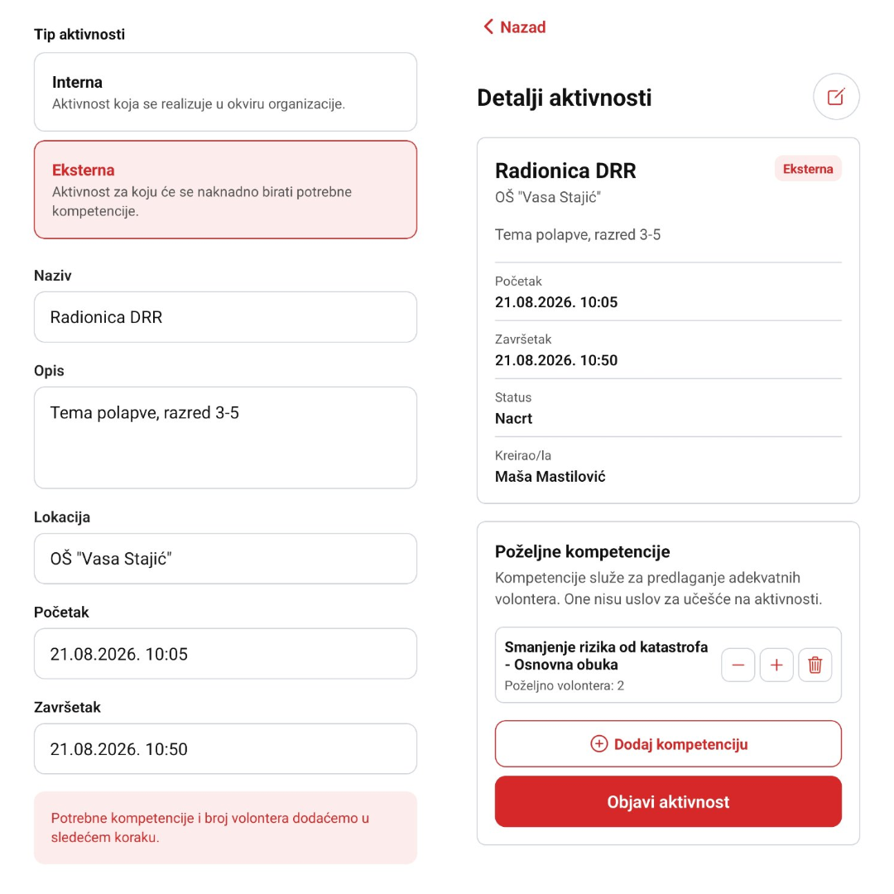
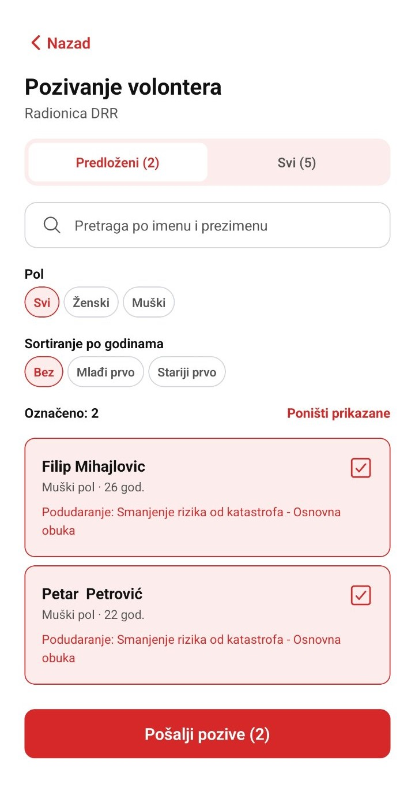
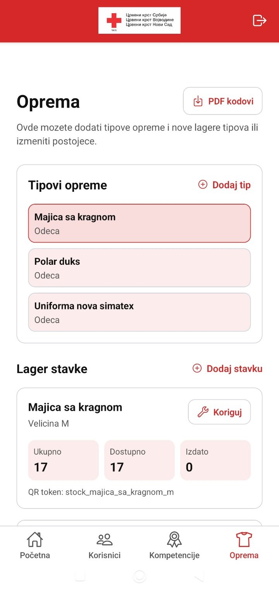

# Red Cross Novi Sad Volunteer Management App

A mobile application developed as a bachelor's thesis project at the Faculty of Technical Sciences, University of Novi Sad, to support volunteer management and activity organization at the Red Cross of Novi Sad.

The solution was designed through interviews with intended users, analysis of their existing work processes, and system modeling. It centralizes volunteer records, competencies, activities, equipment, and reporting in one role-based mobile application.

## User Roles

| Role | Main Responsibilities |
| --- | --- |
| Administrator | Manages users, competencies, and equipment records. |
| Employee | Organizes external activities, invites volunteers, manages equipment, and reviews reports. |
| Instructor | Creates internal activities and records volunteer attendance. |
| Volunteer | Maintains a profile and competencies, responds to invitations, records attendance, and submits activity reports. |

## Key Features

- Volunteer profiles and competency records
- Internal and external activity management
- Competency-based volunteer suggestions and invitations
- Invitation response tracking and QR-code attendance recording for internal activities
- Activity reports with photo attachments
- Equipment inventory, QR-code-based issue and return workflows, and assignment tracking
- Role-based navigation and access control

## Technology Stack

- React Native
- Expo and Expo Router
- TypeScript
- Firebase Authentication and Cloud Firestore
- Cloudinary
- QR code generation and scanning
- PDF export and sharing

## Screenshots

### Activity Management

### Volunteer Suggestions

### Equipment Inventory

